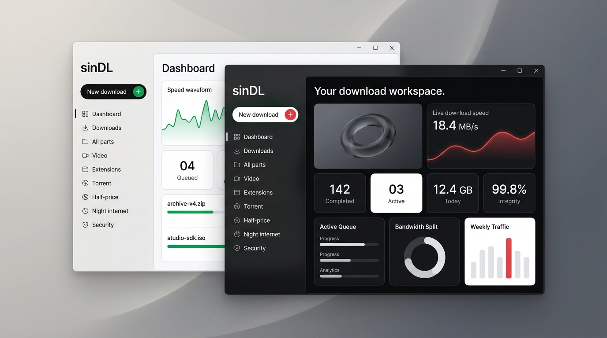
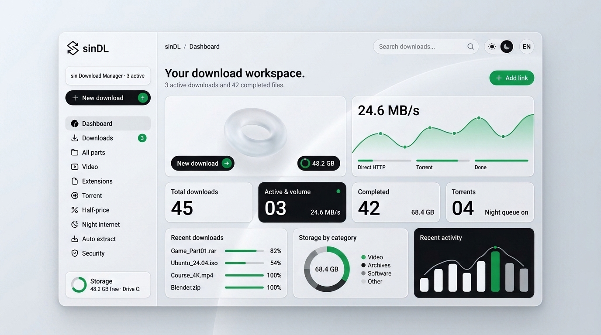
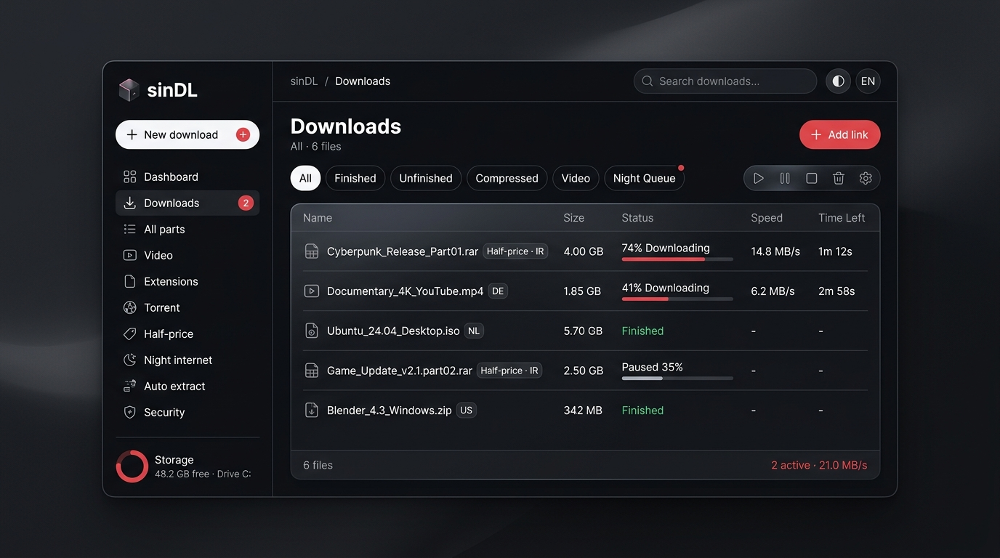

# sin Download Manager (`sinDL`)

A fast, privacy-respecting Windows download manager tailored for Iranian networks and everyday large downloads — built on [AB Download Manager](https://github.com/amir1376/ab-download-manager) with a clean monochrome workspace (**Porcelain Light** with emerald download accents and **Obsidian Dark** with crimson download accents), native Persian (RTL) and English UI, built-in torrent & video engines, automatic archive extraction and part repair, and domestic half-price traffic detection.

  

  <a href="https://github.com/siinsiw/sin-download-manager/releases/latest"><strong>Download Latest Windows Installer (.exe)</strong></a>
  &nbsp;&middot;&nbsp;
  <a href="#features">Features</a>
  &nbsp;&middot;&nbsp;
  <a href="#browser-extensions">Browser Extensions</a>
  &nbsp;&middot;&nbsp;
  <a href="#security-model">Security Model</a>

---

## Interface & Workspace

sinDL pairs a calm monochrome dashboard with live telemetry, instant theme switching, and full Persian (RTL) / English (LTR) support:

| Porcelain Light — Workspace Dashboard | Obsidian Dark — Downloads Manager |
| :---: | :---: |
|  |  |
| Live speed waveform, disk headroom gauge, active counters, category storage breakdown, and 5-day activity trend — accented in **emerald green**. | Frosted glass table with half-price / server-country badges, status/category/queue filter pills, drag-and-drop organization, and slim **crimson red** progress tracks. |

---

## Features

### Built for Iranian Networks
- **Domestic Half-Price Detection (`نیم‌بها`)**: Resolves final CDN servers through up to 5 HTTP redirects using embedded RIPE Iranian IPv4 + IPv6 tables, and labels domestic half-price links directly inside the download list and add dialog.
- **Server Registration Country**: Displays the server's registration country code (`DE`, `NL`, `US`, etc.) alongside full-price links using an offline IPv4 geolocation database (zero external tracking requests).
- **Torrents Without VPN**: Binds libtorrent directly to the physical network adapter (bypassing common VPN tunnels such as Hiddify/sing-box, Clash, WARP, Amnezia, etc.), disables stalled uTP on direct routes, and announces across all public trackers automatically.
- **Night Internet Queue & Auto-Wake**: Dedicated scheduled night queue (default `02:00–07:00`) with optional automatic shutdown when finished, plus a Windows wake timer that wakes the PC from sleep only when pending downloads are actually queued.

### Multi-Part Games, Archives & Smart Repair
- **All Parts & Release Picker**: Paste any download page URL (such as multi-release game pages with ElAmigos, RUNE, FitGirl, Updates, Cracks, and Optional packs). sinDL groups each release with its live total size, picks domestic half-price mirrors as primary links, uses alternate hosts as live mirrors, and auto-detects archive passwords written on the page.
- **Auto Extract (`.rar`, `.zip`, `.7z`, `.001`, `.r00`, `.z01`)**: Automatically tests and extracts multi-part archives as soon as the final volume finishes, tries page/known/custom passwords, checks free disk space before unpacking, and optionally deletes archive files afterward.
- **Exact Broken-Part Repair**: Verifies per-volume packed CRC headers on RAR4/RAR5 archives, checks file sizes and error-page signatures, and automatically re-downloads **only** the damaged part instead of restarting a 60 GB download.
- **Long Link Lists & Page Images**: Import links from UTF-8 / Windows-1256 text files, generate numbered batch patterns, extract all images from any web page, or let the subtle corner clipboard card catch copied download links, magnet URIs, and video URLs.

### Video, Playlists & Torrents
- **Video & Playlist Downloader (`yt-dlp` + `ffmpeg`)**: Download videos and audio from YouTube, Aparat, Instagram, Vimeo, Twitch, and thousands of supported sites at your chosen quality. High-resolution video and audio streams are downloaded with multi-connection acceleration (including 10 MB range chunking for YouTube throttling) and merged losslessly with `ffmpeg`. Supports full playlists, manual + automatic Persian/English subtitles saved alongside the video, app proxy forwarding, and one-click verified `yt-dlp` updates.
- **Built-In Torrent Engine (`libtorrent`)**: Supports `.torrent` files and `magnet:` links, selective file picking with search/filter, sequential downloading for media preview, configurable share-ratio stop limit, upload speed cap to save metered bandwidth, seeding disabled after completion by default, and automatic RSS feed subscriptions.

### Speed, Storage & File Protection
- **Smart Speed & Busy-Hour Cap**: Automatically scales connection count (1–16) by file size, splits slow segments dynamically, downloads simultaneously from mirror links, and optionally caps download speed only while you are actively using the PC.
- **Disk Space Guard**: Calculates sparse-aware remaining space across concurrent downloads (including extraction overhead) and pauses items before a drive runs dry.
- **File Guard & Crash Recovery**: Detects HTML, XML (S3/CDN), and JSON error pages disguised as binary files, resets them cleanly, and automatically resumes interrupted transfers after a power cut or unexpected restart.
- **Duplicate Finder & List Cleaner**: Spots duplicate links and numbered copies (`file_1.ext`) by comparing content before sending extras safely to the Windows Recycle Bin.

---

## Installation

1. Download **`sinDL_<version>_windows_x64.exe`** from the **[Latest Release](https://github.com/siinsiw/sin-download-manager/releases/latest)** and run it.
2. Because the installer is not commercially code-signed, Windows SmartScreen may show *"Windows protected your PC"*. Click **More info** → **Run anyway**.
3. Switch between **Persian / English** and **Light / Dark** themes anytime from the top bar.

---

## Browser Extensions

sinDL includes a dedicated **Extensions & Browser** section right inside the app with step-by-step setup instructions and offline packaging. Both extensions work together without conflict:

1. **Browser Download Catcher (Chrome, Edge, Firefox, Opera)**:
   - Install the official AB Download Manager browser extension ([Chrome / Edge / Brave](https://chromewebstore.google.com/detail/bbobopahenonfdgjgaleledndnnfhooj) · [Firefox](https://addons.mozilla.org/firefox/addon/ab-download-manager/)). sinDL uses the same localhost bridge (`127.0.0.1:15151`) and works with it out of the box.
2. **sinDL Video Download Button (Chrome, Edge, Brave)**:
   - Adds a floating **"Download with sinDL"** button over videos on YouTube, Aparat, Instagram, and embedded `iframe` players.
   - Bundled offline inside the app: open **Extensions & Browser** in sinDL → click **Prepare & open extension folder** → open `chrome://extensions` (or `edge://extensions`) → enable **Developer mode** → click **Load unpacked** and choose the prepared `video-extension` folder.
   - Standalone ZIP packages are also available on the [Releases page](https://github.com/siinsiw/sin-download-manager/releases/latest).

---

## Security Model

- **Localhost Origin Guard**: Local API ports (`127.0.0.1:15151` and the single-instance IPC port) strictly validate `Host` and `Origin` headers, rejecting requests from regular websites so web pages cannot trigger hidden downloads.
- **Windows Antivirus & Mark-of-the-Web**: Finished downloads, extracted executables/scripts, and completed torrent files are scanned through Windows `IAttachmentExecute` (invoking your installed antivirus) and tagged with `:Zone.Identifier` just like web browsers (configurable under **Security**).
- **Large-File Permission Prompt**: Optionally ask for confirmation before starting downloads over a custom size threshold (multi-part archives are approved together as a single prompt).
- **Checksum-Verified Companion Tools**: `yt-dlp`, `ffmpeg`, and `Deno` are only installed or updated after their SHA-256 checksum matches the verified release digest.
- **No Administrator Privileges Required**: Runs strictly under your standard user account.

---

## Attribution & License

sinDL is built on [AB Download Manager](https://github.com/amir1376/ab-download-manager) by AmirHossein Abdolmotallebi and is distributed under the **Apache License 2.0**. See [LICENSE](LICENSE) and [NOTICE](NOTICE) for full license text and third-party component attributions.
